# Awesome DIFF & Pager Utilities 🔍⚡

  

  
  
  
  
  

---

## 📖 Curated Ecosystem: Diff, Merge & Syntax-Aware Pager Utilities 🚀

> **The ultimate curated directory of high-performance git pagers, AST-aware structural diff engines, visual 3-way merge tools, and code change inspection platforms.**

**Last updated: October 2026** 📅

This repository tracks notable **SaaS platforms** and **open-source GitHub projects** for **Diff & Pager Utilities**. These tools empower software engineers, DevOps leads, and code reviewers to read pull requests and local code changes with optimal clarity—from syntax-highlighted terminal pagers that elevate `git diff` to semantic tree-sitter diff engines that understand code structure rather than plain lines.

*Looking for fast terminal workflows, side-by-side terminal views, or graphical merge conflict resolution? This list covers the category leaders and rising stars.* 🌟

---

## 📑 Table of Contents

- [📊 Sector Overview & Market Dynamics](#-sector-overview--market-dynamics)
- [🏢 SaaS & Hosted Platforms](#-saas--hosted-platforms)
- [💻 Open-Source GitHub Projects](#-open-source-github-projects)
- [🤝 How to Contribute](#-how-to-contribute)
- [💖 Support & Sponsorship](#-support--sponsorship)
- [📈 Star History](#-star-history)
- [⚠️ Disclaimer](#️-disclaimer)

---

## 📊 Sector Overview & Market Dynamics

The dedicated code review, diff visualization, and inspection tools sector represents an estimated **$2B–$3B** submarket within the broader **$150B+** software development tooling industry, expanding quickly as AI-assisted software generation accelerates pull-request volume and code churn. The market is **moderately fragmented**: centralized DevOps titans (GitHub, GitLab, Atlassian Bitbucket) capture baseline mainline peer review and repository hosting, while specialized diff engines and terminal/GUI utilities thrive as defensible, best-of-breed software for deep AST semantic analysis, complex 3-way merges, and high-productivity local file comparisons.

---

## 🏢 SaaS & Hosted Platforms

| Product | Valuation / Revenue | Pricing | Free Tier Limit | Highlights |
| :--- | :--- | :--- | :--- | :--- |
| **[P4Merge](https://www.perforce.com/products/helix-core/merge-diff-tool-p4merge)** (Perforce) | ~$750M Revenue (Enterprise Valuation >$1B PE-backed) | $0 (Free standalone tool; Helix Core starts at $51/user/month) | Free forever (Unlimited standalone visual 2-way/3-way diff & merge; Helix Core free for up to 5 users/20 workspaces) | Enterprise visual diff and 3-way merge utility with image comparison, directory diff, and conflict resolution. |
| **[Araxis Merge](https://www.araxis.com/merge/)** (Araxis) | ~$2M Revenue | $129 one-time perpetual (Standard edition, 1-4 users; $269 for Pro edition) | 30-day free trial (Full evaluation access to all Professional 3-way compare and merge features; no perpetual free tier) | Enterprise-grade visual file comparison with 3-way merge, automation CLI/API, and folder synchronization. |
| **[Beyond Compare](https://www.scootersoftware.com/)** (Scooter Software) | ~$500K–$1M Revenue | $35 one-time perpetual (Standard edition, 1-4 users; $70 for Pro edition) | 30 days of actual use free trial (Full access to all Pro features with no daily limits; no perpetual free tier) | Commercial standard for file, folder, table, and FTP comparison with 3-way merge and multi-platform support. |

---

## 💻 Open-Source GitHub Projects

Sorted by GitHub Stars_Count (descending) 🌟:

- **[delta](https://github.com/dandavison/delta)**  🦀  
  **A syntax-highlighting pager for git, diff, and grep output** (MIT) — *The modern terminal diff standard*. Configurable as a drop-in replacement via `core.pager = delta`. Delivers line numbers, side-by-side view (`-s`), word-level diffing, n-jump hunk navigation, and themes powered by `bat`/`syntect` (Dracula, Nord, Monokai, Solarized).

- **[difftastic](https://github.com/Wilfred/difftastic)**  🌳  
  **A structural diff tool that understands syntax** (MIT) — *The semantic diff revolution*. Parses code into ASTs using tree-sitter across 30+ languages. Understands variable renaming, moved function blocks, and formatting tweaks without triggering false-positive line changes.

- **[diff-so-fancy](https://github.com/so-fancy/diff-so-fancy)**  ✨  
  **The minimalist's diff beautifier** (MIT) — *Clean, human-readable terminal output*. Removes cluttering diff headers and +/- indicators, replacing them with subtle highlight colors and clear file hunk breaks with zero configuration overhead.

- **[WinMerge](https://github.com/WinMerge/winmerge)**  🪟  
  **Differencing and merging tool for Windows** (GPL-2.0) — *The classic visual comparison powerhouse*. Delivers graphical side-by-side text, directory, table, and image comparisons with inline editor capabilities, shell integration, and syntax highlighting.

- **[diff-pdf](https://github.com/vslavik/diff-pdf)**  📄  
  **Visual comparison tool for PDF documents** (GPL-2.0) — *Precision document diffing*. Visually compares two PDF files side-by-side or as an overlaid graphic diff highlighting page layout and typography deviations.

- **[git-split-diffs](https://github.com/banga/git-split-diffs)**  🪓  
  **Syntax-highlighted side-by-side diffs in terminal** (MIT) — *GitHub-style side-by-side view in CLI*. Splits unified diffs across terminal columns with character-level change highlighting and theme support.

- **[git-cola](https://github.com/git-cola/git-cola)**  🥤  
  **Sleek and powerful Git GUI and visual diff review client** (GPL-2.0) — *Cross-platform Git workhorse*. Features customizable diff viewers, partial hunk staging, DAG history visualizer, and keyboard-centric operation.

- **[diffnav](https://github.com/dlvhdr/diffnav)**  🗂️  
  **Interactive git diff pager with a GitHub-style file tree** (MIT) — *Fast navigation across large PRs*. Built on top of delta to combine syntax highlighting with a collapsible file tree pane directly in terminal.

- **[Meld](https://github.com/GNOME/meld)**  🐧  
  **Visual diff and merge tool targeted at developers** (GPL-2.0) — *The GNOME/GTK choice*. Supports two- and three-way visual comparisons of files and folders with live buffer editing and deep Git/SVN/Mercurial integration.

- **[ydiff](https://github.com/ymattw/ydiff)**  📟  
  **Side-by-side and auto-paged incremental colored diff tool** (BSD-3-Clause) — *Lightweight CLI visualizer*. Formats unified diffs into clean side-by-side columns with paging support in any ANSI terminal.

- **[KDiff3](https://github.com/KDE/kdiff3)**  🧩  
  **Utility for comparing and merging files and directories** (GPL-2.0) — *The three-way merge reference*. Character-by-character diff precision, automatic merge conflict resolution, and integrated directory tree synchronization.

- **[diffr](https://github.com/mookid/diffr)**  ⚡  
  **LCS-based diff highlighting tool to ease code review** (MIT) — *Word-level diff refinement*. Reads unified diff input on stdin and highlights exact character and word changes when standard line diffs are too coarse.

---

## 🛠️ Recommended Stacks & Workflows

- **Daily Terminal Driver**: Pair **`delta`** (`core.pager = delta --side-by-side --line-numbers`) with Git for readable, theme-aware terminal diffs.
- **Structural Code Reviews**: Use **`difftastic`** when reviewing major refactors, renamed variables, or code formatting updates.
- **Large Changeset Navigation**: Use **`diffnav`** for terminal sessions where navigating hundreds of modified files via a tree explorer is required.
- **Complex Conflict Resolution**: Rely on **`KDiff3`**, **`Meld`**, or **`WinMerge`** for 3-way visual resolution when merging diverged upstream branches.

---

## 🤝 How to Contribute

Contributions are warmly welcomed! 🌟

1. 🍴 Fork the repository.
2. 📝 Add or update tools in `README.md` keeping alphabetical/star-sorted order and factual descriptions.
3. 🔗 Verify all links, licenses, and official websites.
4. 🚀 Open a Pull Request with a short summary of the addition.

---

## 💖 Support & Sponsorship

If you find this curated list helpful for your development workflow, please consider supporting the project:

- ⭐ **Star this repository** to help others discover it!
- 🍴 **Fork and share** with fellow developers and teams.
- ☕ **Buy a coffee or sponsor** ongoing maintenance via the [GitHub Sponsors Dashboard](https://github.com/sponsors/ishandutta2007).

Your support keeps this resource open, accurate, and continually updated! Thank you! ❤️

---

## 📈 Star History

---

## ⚠️ Disclaimer

- This is a community-curated list and not an endorsement of any commercial product.
- **Pager vs. Diff Engine vs. Visual Merge Tool**:
  - *Pagers* (`delta`, `diff-so-fancy`, `diffnav`, `diffr`) beautify and paginate existing Git/CLI diff output.
  - *Diff Engines* (`difftastic`) parse files into ASTs and compute structural differences independently.
  - *Visual Merge Tools* (`WinMerge`, `Meld`, `KDiff3`, `Araxis Merge`, `Beyond Compare`, `P4Merge`) offer GUI editors and three-way conflict resolution.
- Always observe appropriate security practices when inspecting diffs and code patches from untrusted sources.

---

  <b>Crafted with ❤️ for developers, code reviewers, and engineers building transparent diff workflows.</b>

